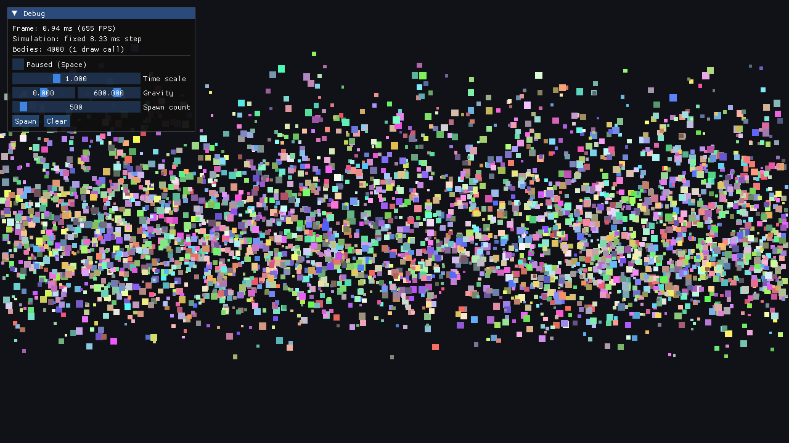

# cpp-game-template

[](https://github.com/barisdoguy/cpp-game-template/actions/workflows/ci.yml)
[](LICENSE)

A small C++20 starting point for games and graphics experiments, laid out the way production code is. It opens a window, simulates thousands of bouncing bodies on an entity-component system with a fixed timestep, draws all of them in one batched draw call, and shows a Dear ImGui debug panel.



## Design decisions

| Decision | Why |
|---|---|
| **Simulation is separate from the platform layer.** `game_core` has no SDL, ImGui or rendering code. | Game logic is unit-tested headless in CI and can be reused by a dedicated server or an editor tool. |
| **Fixed timestep with a "spiral of death" guard** (`src/core/FixedTimestep.hpp`) | Physics behaves the same at 30 and 240 FPS, and replays from the same inputs are reproducible. |
| **ECS with [EnTT](https://github.com/skypjack/entt)** | Components are plain data and systems are functions over views: cache-friendly and easy to test. |
| **Batched rendering**: every body goes into one `SDL_RenderGeometry` call | One draw call instead of thousands, with vertex buffers reused across frames. |
| **Pinned dependencies** through CMake `FetchContent` | Every machine and CI runner builds exactly the same library versions. No manual installs. |
| **Strict warnings, warnings as errors in CI, ASan/UBSan job, clang-format check** | Problems are caught on the pull request instead of in a crash report. |
| **Headless smoke test**: `--frames N --screenshot out.png` with SDL's offscreen driver | CI runs the real executable on every push and uploads what it rendered. |

## Dependencies

All are fetched at configure time. Versions live in [`cmake/Dependencies.cmake`](cmake/Dependencies.cmake).

| Library | Version | Purpose |
|---|---|---|
| [SDL3](https://github.com/libsdl-org/SDL) | 3.4.20 | Window, input, 2D renderer |
| [Dear ImGui](https://github.com/ocornut/imgui) | 1.92.9b | Debug UI |
| [EnTT](https://github.com/skypjack/entt) | 3.16.0 | Entity-component system |
| [glm](https://github.com/g-truc/glm) | 1.0.3 | Vector and matrix math |
| [spdlog](https://github.com/gabime/spdlog) | 1.17.0 | Logging |
| [doctest](https://github.com/doctest/doctest) | 2.5.3 | Unit tests |

## Building

You need CMake 3.28+, Git, a C++20 compiler and, for the presets, Ninja. On Linux, also install the X11/Wayland development packages (the exact list is in [`.github/workflows/ci.yml`](.github/workflows/ci.yml)).

Linux and macOS:

```bash
cmake --preset release
```

```bash
cmake --build --preset release
```

```bash
ctest --preset release
```

```bash
./build/release/game
```

Windows with Visual Studio 2022:

```bash
cmake --preset vs2022
```

```bash
cmake --build --preset vs2022-release
```

The executable is written to `build\vs2022\Release\game.exe`.

Other presets: `debug`, and `asan` (Debug build with AddressSanitizer and UBSan, GCC/Clang only).

## Controls

| Input | Action |
|---|---|
| `Space` | Pause / resume |
| `Esc` | Quit |
| Debug panel | Time scale, gravity, spawn and clear bodies |

## Command line

```text
game [--bodies N] [--frames N [--screenshot FILE.png]]
  --bodies N           bodies spawned at start (default 2000)
  --frames N           quit after N frames (headless smoke tests)
  --screenshot FILE    save the last frame as PNG (requires --frames)
```

Run without a display, for example on a CI server:

```bash
SDL_VIDEO_DRIVER=offscreen ./build/release/game --frames 600 --screenshot shot.png
```

## Project layout

```text
cmake/                 dependency pins, warning flags, sanitizers
src/core/              engine-agnostic utilities (FixedTimestep)
src/game/              components and systems: pure simulation, unit-tested
src/app/               platform layer: SDL window, renderer, input, ImGui
src/main.cpp           command line and entry point
tests/                 doctest unit tests for core and game
.github/workflows/     CI: Linux GCC/Clang, Windows MSVC, macOS, sanitizers, format
```

## Roadmap

- [ ] Spatial-hash broad phase and body-to-body collisions
- [ ] Render interpolation with `FixedTimestep::alpha()`
- [ ] [Tracy](https://github.com/wolfpld/tracy) profiler zones
- [ ] Move from `SDL_Renderer` to the SDL GPU API (Vulkan / D3D12 / Metal) for 3D
- [ ] Asset loading with [stb_image](https://github.com/nothings/stb) and [cgltf](https://github.com/jkuhlmann/cgltf)

## License

[MIT](LICENSE). Third-party libraries keep their own licenses: SDL3 (zlib), Dear ImGui, EnTT, spdlog, doctest (MIT), glm (MIT or Happy Bunny).
